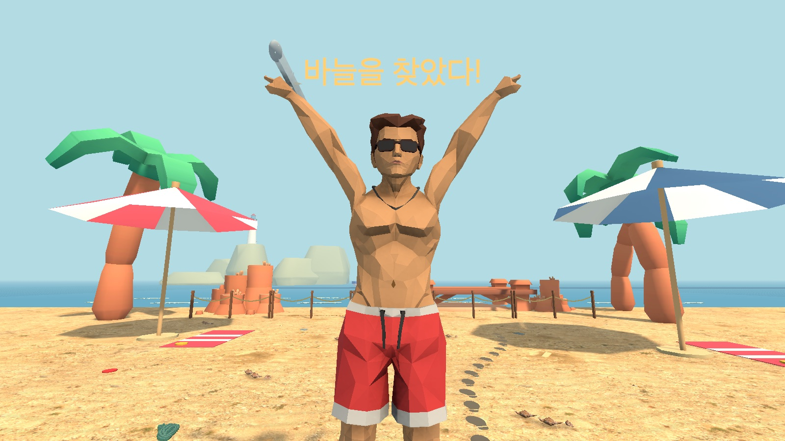
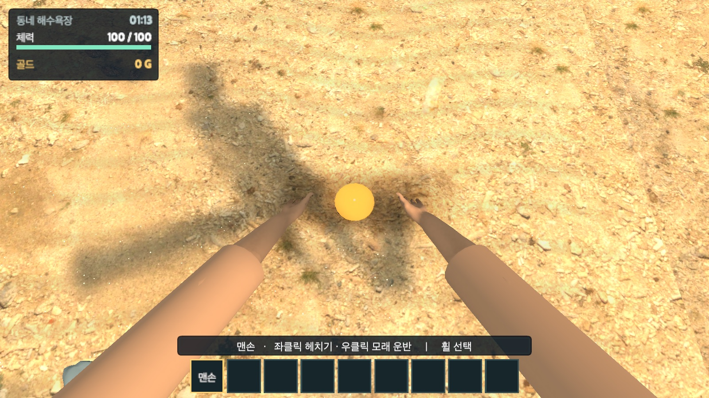
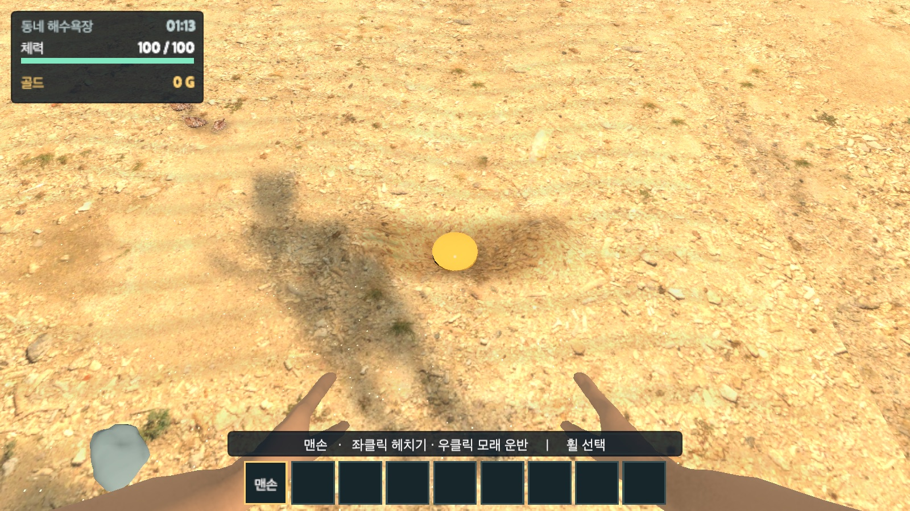
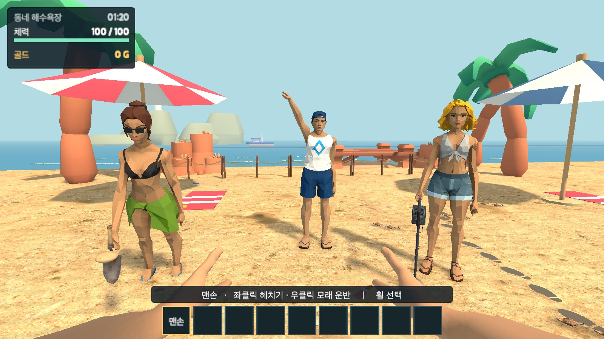
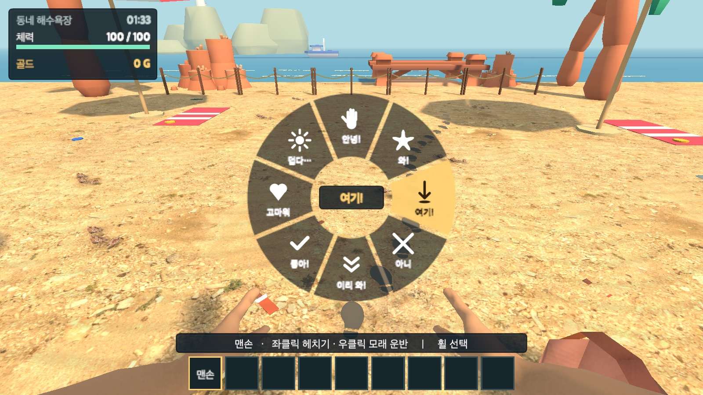
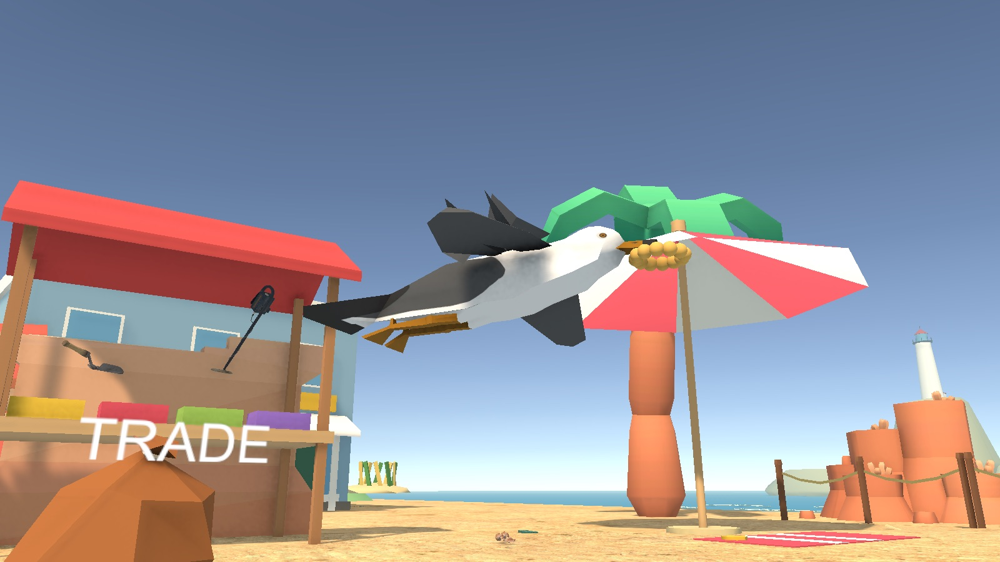
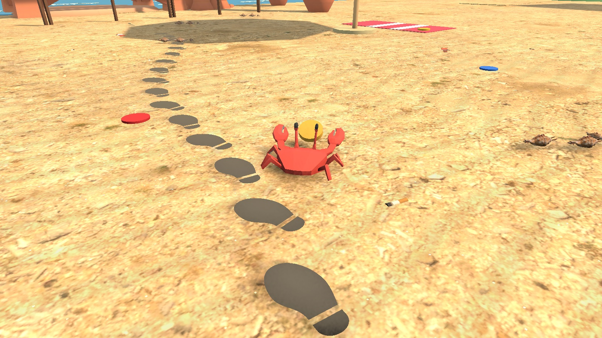
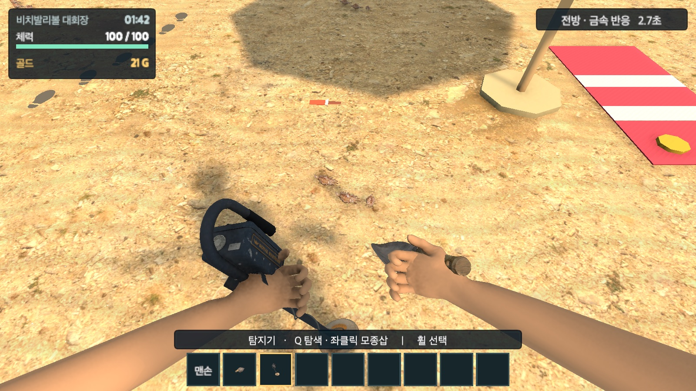
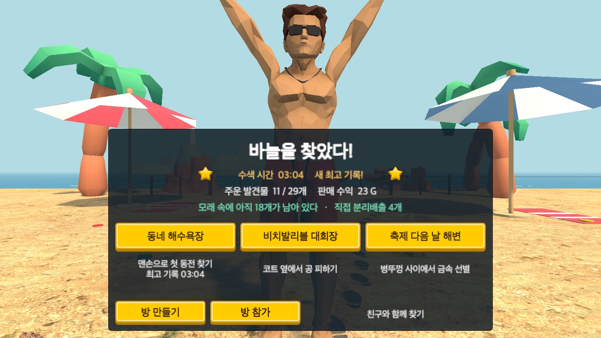

# FindNeedle — 모래사장에서 바늘 찾기

친구와 함께 해변 모래를 헤쳐 숨은 바늘 하나를 찾는 **1인칭 협동 탐색 게임**입니다.
바늘을 찾는 동안 모래에서 나오는 쓰레기를 주워 분리배출하면서 해양 쓰레기 문제를 함께 이야기합니다.

| | |
|---|---|
| **기간** | 2026.11.08 ~ 진행 중 |
| **인원** | 1인 (기획 · 프로그래밍 · 문서) |
| **엔진 / 언어** | Unity 6000.3 (URP) / C# |
| **주요 기술** | Netcode for GameObjects · Steamworks.NET (친구 초대 · P2P 전송 · 음성) · Input System · Unity Test Framework |
| **플랫폼** | macOS · Windows 스탠드얼론 (Steam) |
| **규모** | 스크립트 54개 · 약 12,100줄 (게임 코드 약 10,100줄 + 테스트 약 2,000줄) · 자동 테스트 62개 |



| 맨손으로 모래 헤치기 | 묻혀 있던 동전이 드러남 |
|---|---|
|  |  |
| 두 손으로 밀어낸 만큼 지형이 실제로 깎이고 양옆에 둔덕이 쌓입니다 | 몇 번 헤치면 묻힌 물건이 드러나고, 손가락 자국이 남습니다 |

| 협동 플레이 | 감정 표현 원 |
|---|---|
|  |  |
| 동료가 든 도구, 손짓, 파는 동작이 그대로 보입니다 | 휠 버튼을 누르고 있으면 8칸 원이 열리고, 고른 손짓이 동료에게 전달됩니다 |

| 갈매기 | 게 |
|---|---|
|  |  |
| 아무도 지키지 않는 자루에서 가장 반짝이는 물건을 물어 갑니다 | 꺼내 두고 간 작은 물건을 굴로 끌고 가 묻습니다 |

| 탐지기 | 결과 화면 |
|---|---|
|  |  |
| 앞쪽 모래 속 금속에 반응합니다 | 수색 시간, 주운 발견물, 수익, 분리배출 수를 집계합니다 |

> 나머지 캡처(해변 3종 전경, 모종삽, 더위, 메인 메뉴 등)는 [docs/screenshots](docs/screenshots)에 있습니다.

---

## ⚠️ 이 저장소에 대하여

원본 프로젝트에는 **유료 에셋(Unity Asset Store 캐릭터 팩 등)** 이 들어 있어, 라이선스상 공개 저장소에 올릴 수 없습니다.
그래서 이 저장소에는 **직접 작성한 C# 코드와 셰이더, 설계 문서, 실제 게임 캡처만** 담았고, **그대로 빌드·실행되지 않습니다.**

```
포함  ✅  Scripts/ (직접 작성한 코드와 테스트 전체) · docs/ (기능별 설계 문서 18편 · 기획 · 조사) · 캡처 21장
제외  ❌  3D 모델 · 텍스처 · 사운드 · 씬 · 프로젝트 설정
```

---

## 무엇을 만들었나

**모래 파기** — 모래를 높이·젖은 정도 격자로 관리해 실제로 깎이고 쌓이게 했습니다. 맨손 헤치기, 모종삽으로 뜨고 붓기,
경사면이 무너져 흘러내리는 모래, 젖은 모래, 발자국과 손자국, 튀어 오르는 모래 알갱이를 구현했습니다.

**탐색 도구와 경제** — 금속 탐지기, 삽 속 자석 선별, 갈퀴. 주운 물건은 손에 들고 수거 자루에 모으고,
매입소에서 팔아 팀 골드로 도구와 파라솔을 삽니다. 쓰레기는 분리수거함에 직접 넣습니다.

**해변 3종과 단계** — 동네 해수욕장, 비치발리볼 대회장(날아오는 공), 축제 다음 날 해변(많은 쓰레기, 바다거북 구조).
발견물은 매 판 무작위로 묻히고, 클리어하면 다음 해변이 열립니다.

**해변 사건** — 갈매기와 게. 둘 다 **경고 → 실행 → 포기** 단계로 움직여서 플레이어가 보고 대응할 수 있고,
빼앗긴 물건은 사라지지 않고 다른 곳에 떨어지거나 묻혀서 다시 찾을 수 있습니다.

**더위와 체력** — 그늘 없이 햇볕에 오래 있으면 살갗이 붉어지고 어지러워지며 체력이 깎입니다. 파라솔을 사서 직접 꽂을 수 있습니다.

**협동 멀티플레이** — Steam 친구 초대로 참가하고, 같은 네트워크에서는 주소로 참가합니다.
Steam Networking Sockets 위에 Netcode 전송 계층을 직접 만들어 포트 개방 없이 연결됩니다.
거리에 따라 작아지는 **근접 음성 채팅**, 위치 핑, 감정 표현을 넣었습니다.

**바늘을 찾은 순간** — 바늘을 화면 가운데로 들어 올리고, 3인칭으로 물러나 머리 위로 치켜든 뒤 결과 화면으로 넘어갑니다.
협동에서는 모든 동료의 카메라가 찾은 사람을 향하고 함께 환호합니다.

---

## 설계에서 가장 신경 쓴 것

### 혼자 하는 게임을 협동으로 바꿀 때 게임 로직을 건드리지 않기

처음부터 **해변**(`BeachSearch` — 모래, 발견물, 시간, 결과)과 **플레이어**(`BeachDigger` — 든 도구, 조준, 입력)를 나눴습니다.
플레이어는 해변을 `BeachSearch`의 공개 메서드로만 바꿉니다.

협동을 붙일 때는 이 공개 메서드들이 **한 개의 작은 메시지로 포장**되어 다른 플레이어에게 가도록 했습니다(`BeachSearch.Net.cs`).
판정은 호스트가 하고 게스트는 요청만 보냅니다. 예를 들어 게스트가 물건을 주우면 호스트에 요청하고, 호스트가 모두에게 결과를 알립니다.
늦게 들어온 사람은 해변 전체를 스냅샷으로 먼저 받습니다. 메시지가 어떤 통로로 가는지는 이 코드가 모르기 때문에
Steam 전송과 주소 접속이 같은 코드를 씁니다.

### 모래를 보내는 양 줄이기

모래 높이는 격자로 되어 있어 매 프레임 전부 보낼 수 없습니다. 격자를 **타일 단위로 나누고, 바뀐 타일만** 호스트가 보냅니다.
화면 갱신도 같은 원리로, 바뀐 블록의 정점만 다시 계산합니다(`SandGrid.cs`, `SandPatch.cs`).

### 네트워크 없이 협동을 테스트하기

메시지를 보내는 통로(`Outbox`)를 함수 하나로 바꿀 수 있게 해 두고, 테스트에서는 **메시지를 직접 넘겨** 호스트와 게스트를 한 프로세스 안에서 검증합니다.
실제 연결 확인은 개발 빌드 두 개를 띄워 각각 짧은 세션을 자동으로 플레이시키고, 양쪽이 같은 모래·같은 발견물을 보는지 로그로 비교합니다(`BeachAutopilot.cs`).

### 막을 수는 없지만 대응할 수 있는 방해 요소

갈매기와 게는 플레이어를 괴롭히되 억울하지 않게 만들었습니다. 먼저 경고(맴돌기, 모래 구멍)를 보여 주고, 사람이 다가오면 포기하며,
빼앗은 물건은 해변 어딘가에 남겨 둡니다. 바늘이나 큰 물건은 건드리지 않습니다.

---

## 작업 방식

- **AI 페어 프로그래밍** — Claude Code와 함께 개발했습니다(커밋 18개 중 15개에 공동 작성 표기). 기능을 정하고, 구현을 맡기고,
  결과를 테스트와 실제 화면으로 확인한 뒤 고치는 흐름으로 진행했습니다.
- **기능마다 문서와 테스트** — 기능 하나를 넣을 때마다 설계 문서([docs/기능](docs/기능) 18편)와 자동 테스트를 같이 남겼습니다.
  실제 씬을 플레이 모드로 돌려 모래를 뜨고, 동전을 줍고, 갈매기가 반지를 물어 가는지까지 확인합니다.
- **화면으로 확인** — 보이는 기능은 Unity를 배치 모드로 실행해 실제 게임 화면을 찍어 확인했습니다. 이 저장소의 캡처도 그렇게 찍었습니다.
- **조사 후 결정** — 비슷한 협동 게임을 조사해 방향을 정했고([시장 조사](docs/협동파티게임_시장조사.md)),
  에셋은 상업 이용 조건을 확인한 뒤 골랐습니다([에셋 후보](docs/상업용에셋후보.md)).

---

## 코드 읽는 순서

| | 무엇을 | 어디를 |
|---|---|---|
| 1 | 공유하는 해변 | `Scripts/Core/BeachSearch.cs` |
| 2 | 플레이어 한 명의 입력과 도구 | `Scripts/Core/BeachDigger.cs` |
| 3 | 모래 규칙과 화면 | `Scripts/Excavation/SandGrid.cs` → `SandPatch.cs` |
| 4 | 협동 메시지 | `Scripts/Core/BeachSearch.Net.cs` → `Scripts/Net/BeachNet.cs` |
| 5 | Steam 연결과 음성 | `Scripts/Net/BeachSteamTransport.cs` · `BeachVoice.cs` |
| 6 | 해변 사건 | `Scripts/Beach/BeachGull.cs` · `BeachCrab.cs` |
| 7 | 테스트 | `Scripts/Editor/Tests/` (`BeachPlaySmokeTests.cs`부터) |

---

## 문서

- [플레이 가이드](docs/플레이가이드.md) — 조작과 한 판의 흐름
- [기획 정리](docs/기획정리.md) — 협동 구조, 분리수거, 후속 구상
- [기능별 문서](docs/기능) — 모래 파기, 탐지기, 갈매기, 게, 멀티플레이 등 18편
- [상점 상품과 발견물 목록](docs/아이템목록.md)

에셋 출처와 라이선스는 [상업용 에셋 후보](docs/상업용에셋후보.md)와 [에셋 목록](docs/에셋목록.md)에 정리했습니다.
